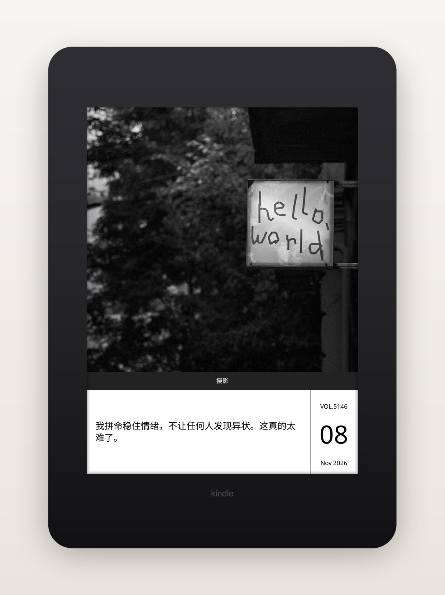
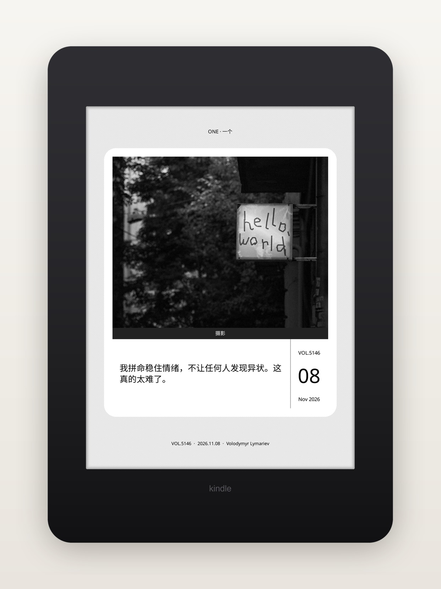
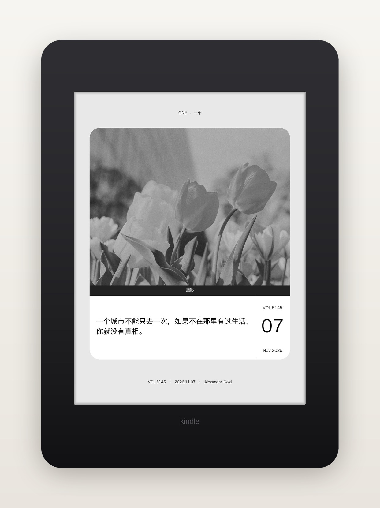
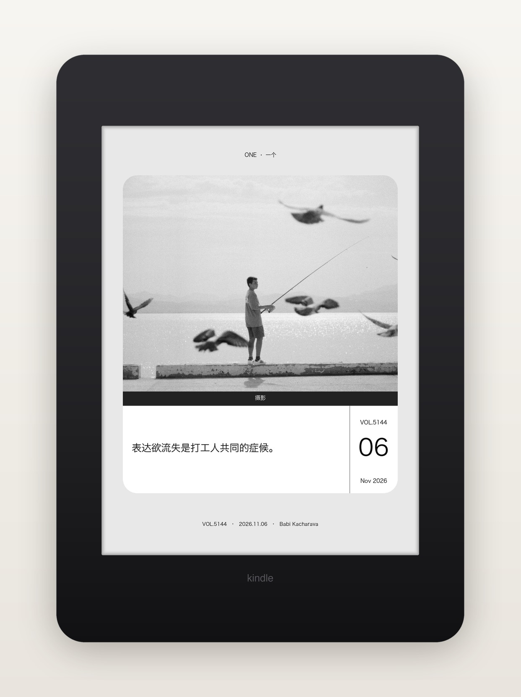

# onepage.koplugin · 一页壁纸

每天（北京时间）从「ONE · 一个」取当日图文，在 Kindle 上本地合成一张设备分辨率的灰阶壁纸：照片 + 一句话 + 期号 + 日期，并自动接管 KOReader 锁屏屏保。

**v0.2.1** · 需要 Kindle 版 KOReader。

## 三种壁纸

| 全屏 | 白底圆角卡 | 满版圆角卡 |
| --- | --- | --- |
| 照片与文字铺满屏幕，还原 ONE App 的图文卡片 | 同一张卡片放进白色圆角卡，浅灰画布留白，卡外有「ONE · 一个」与期号/日期/摄影署名 | 与白底圆角卡同一张卡，但去掉卡内那圈白边：照片与文案块直接顶到卡边 |
| 分区：照片 72.2% / 分类条 4.9% / 文案区 22.9%，日期块占宽 17.6% | 四角按圆弧逐行裁切，照片与文字面板一起变圆 | 同样逐行裁切，圆角直接切在照片上；照片比白底卡宽 7.9%，字号随几何一起放大 |

<!-- strip-for-release:begin
     本节连同标记一起在打包时删除：图片指向仓库 img/，安装 zip 里没有它。
     GitHub 上正常显示。 -->

## 效果

| 全屏 | 白底圆角卡 | 满版圆角卡 |
| --- | --- | --- |
|  |  |  |

满版圆角卡换一天的样子（VOL.5144 · 2026.11.06）：



> 「全屏」「白底圆角卡」是 Kindle 真机渲染的截图；「满版圆角卡」两张按插件同一套版式公式在本地生成，几何与字号一致，只是没有真机的 16 级抖动颗粒。

<!-- strip-for-release:end -->

三种样式都可切换**高对比白**（默认）和**经典灰**配色。浅灰底在 16 级灰墨水屏上容易糊成一片，所以默认用高对比。配色是样式的子选项，不算一种样式。

切换样式或配色时，如果当天图片已缓存，直接离线重绘，不重新联网。

## 安装

1. 从 Releases 下载 `onepage.koplugin-vX.Y.Z.zip`，解压得到 `onepage.koplugin/` 文件夹。
2. USB 连接 Kindle，把整个文件夹放到 `/mnt/us/koreader/plugins/`。
3. 完全退出并重新打开 KOReader，在「工具 → 一页壁纸」中找到菜单。

源码归档（Source code zip）解压后需手动把文件夹改名为 `onepage.koplugin`。

## 菜单

| 菜单项 | 作用 |
| --- | --- |
| 自动配置屏保 | 默认开启。开启前备份原屏保设置，关闭时恢复。 |
| 下载今日一页壁纸 | 手动触发；今日图片已有效时提示已存在，手动请求可跳过 404 冷却。 |
| 壁纸类型 | 全屏 / 白底圆角卡 / 满版圆角卡。 |
| 配色 | 高对比白（默认）/ 经典灰。 |
| 检查插件更新 | 手动检查 GitHub 正式版，校验 SHA-256 后安装并保留回滚备份。 |
| 诊断 | 今日图片/文案状态、网络、屏保配置、当前样式与配色、最近请求结果。 |

## 数据与缓存

正常路径 3 次请求（图文 id 列表 → 图文详情 → 图片）；如果 `data[1]` 不是今天，会按日期顺序最多再探测 9 次详情，最坏 12 次。整条链路共享 60 秒预算：

```text
GET http://v3.wufazhuce.com:8000/api/hp/idlist/0?version=3.5.0&platform=android
GET http://v3.wufazhuce.com:8000/api/hp/detail/{id}?...
GET http://image.wufazhuce.com/...?imageMogr2/thumbnail/1080x/format/jpg
```

图片经 CDN 缩略到 1080 宽（实测约 75 KB，原图约 774 KB），避免 Kindle 解码大图时内存吃紧。全部请求在后台子进程执行，单次请求 20 秒、整条任务 60 秒，不阻塞阅读界面；每次请求的超时都会裁剪到剩余预算，好让子进程在父进程强杀之前报「超时」并清掉临时文件。

图片只允许从 `image.wufazhuce.com` 下载。接口是明文 HTTP，若响应被篡改、把 `hp_img_url` 指向别的域名，插件会拒绝下载而不是照单全收；3xx 重定向也只允许同域名跳一次。

本地文件：

```text
/mnt/us/koreader/screenshots/onepage/YYYYMMDD.jpg        原图（缩略后）
/mnt/us/koreader/screenshots/onepage/YYYYMMDD.json       当日文案元数据
/mnt/us/koreader/screenshots/onepage/wallpaper/           渲染缓存 PNG
/mnt/us/koreader/screenshots/onepage/wallpaper/display/wallpaper.png   实际屏保图
```

只有校验通过的 PNG 才会发布到 `display/`。渲染失败、接口未发布、断网时保留上一张可用壁纸，不显示空白屏保。今日内容未发布按 404 处理，冷却 2 小时；接口结构异常、CDN 换域名、缺少 JSON 解码库这类不会自愈的故障冷却 1 小时（诊断页会显示剩余时间，手动下载可跳过冷却）。跨午夜按北京时间自动换图。

如果设备上**一张图都还没有**（全新安装、第一次就失败），插件会写一张「今日图文暂不可用 / 联网后会自动更新」的浅灰占位图到 `display/wallpaper.png`，避免屏保回退到 KOReader 自带的 `resources/koreader.png` 图标。这张图不参与按日缓存，下一次成功渲染会直接覆盖。

壁纸**始终按竖版渲染**，哪怕锁屏那一刻屏幕是横的。原因在 KOReader 自己：`Screensaver:show()` 会先问 `modeExpectsPortrait()`，而 `random_image` 永远返回 true——它把 framebuffer 强制转回竖屏、把 `screen_w/screen_h` 对调，再按竖版矩形拼图。所以渲染成横版没有意义，只会被它压回竖屏变成一张变形的图。横着拿时屏保会跟着歪 90°，这是 KOReader 的既定行为。

同一天的缓存只在「同日期 + 同样式 + 同配色 + 同分辨率」被新渲染取代时才删除，换样式、换配色不会互相顶掉；分辨率对不上的旧文件（早期版本按当前方向渲染留下的横版）会被直接清掉，避免被当成回退候选发布出去。

元数据缺失时渲染器退化为「纯照片 + 日期」，不会出现方块字或空白文案。

## 已知限制

- 依赖非官方 v3 接口（`http://v3.wufazhuce.com:8000`，明文 HTTP，无鉴权、无 SLA）。接口变更或下线时，插件会保留最近一张可用壁纸；PC HTML 兜底解析器留待后续版本。
- 图片域名白名单固定为 `image.wufazhuce.com`；CDN 若迁移域名，需要随版本更新。
- 首版只做壁纸，不提供文章/问答阅读与历史任意日期回看（那是 one.koplugin 的职责）。
- 中文渲染依赖 KOReader 内置 `cfont` 字体与 `TextBoxWidget`；字形缺失时自动缩字号、超长句省略，仍失败则退纯照片。
- 桌面离线单测不跑渲染管线（`fb` / `TextBoxWidget` / dither），排版数值可以断言，最终成像仍需实机确认。

## 开发检查

```sh
python3 -m pip install lupa
python3 -m unittest discover -s tests -v
python3 scripts/probe.py            # 联网核对今日接口字段
sh scripts/package_release.sh      # 生成安装 zip
```

测试用 `lupa` 的 Lua 运行时加载插件源码，不访问网络、不需要 KOReader。`tests/test_core.py` 覆盖纯逻辑：日期定位、字段解析、URL 归一化、三套样式的版式边界与圆角 inset，外加全部 Lua 文件的语法编译检查。`tests/test_pipeline.py` 把 `socket.http` / `ssl.https` / `libs/libkoreader-lfs` / `ffi/sha2` / `ffi/archiver` 换成本地替身，跑完整请求与解包流程——重定向越权、超长响应、坏图、zip 路径穿越、摘要不符、安装回滚都在这里断言。

真机验证按 [`docs/field-test.md`](docs/field-test.md) 走：先跑五分钟冒烟，再逐条过 16 项，故障注入与取证都在同一篇里。

```sh
scripts/deploy_usb.sh /Volumes/Kindle --fresh   # 装到 Kindle 并清空缓存
scripts/collect_logs.sh /Volumes/Kindle         # 取回 crash.log 与渲染出的 PNG
```

## 声明

本项目仅供个人学习使用，不得用于商业用途。图文内容版权归「ONE · 一个」及原作者所有；插件只在设备本地缓存，不上传、不分发图片或文案。请遵守其用户协议与相关法律法规。

## 参考

- 调度、屏保接管、PNG 发布与回滚：[danxiangli.koplugin](https://github.com/iamzhangjinpeng/danxiangli.koplugin)
- 中文排版、16 级灰抖动输出：[yiyan.koplugin](https://github.com/iamzhangjinpeng/yiyan.koplugin)
- ONE 接口字段与日期反查：[one.koplugin](https://github.com/finlater/one.koplugin)
